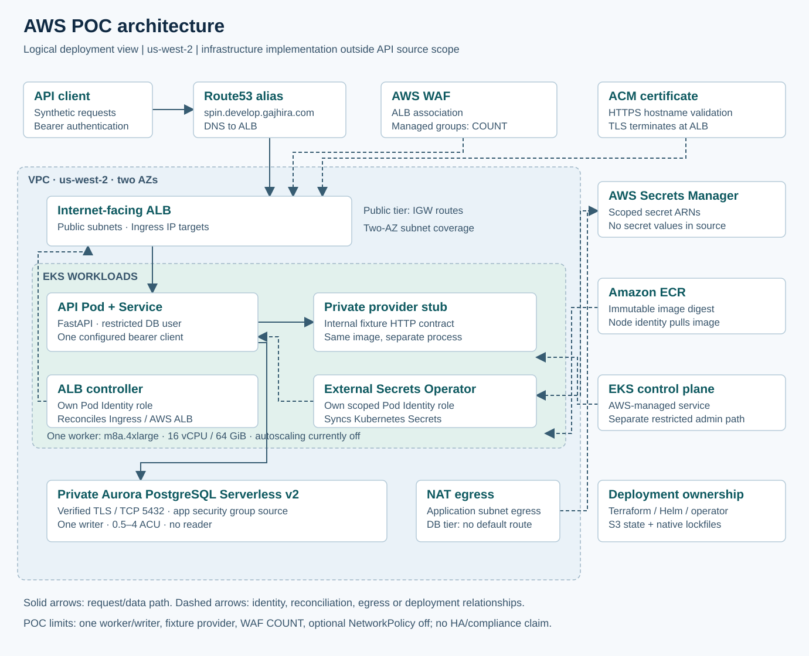
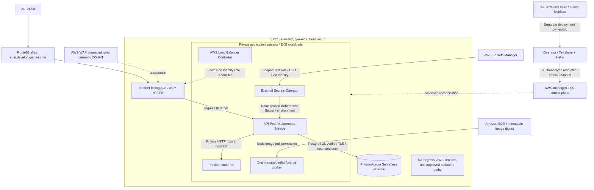

# Optional AWS POC architecture

## Request and data path

Route53 aliases the public hostname to ALB. ACM supplies the HTTPS certificate; WAF is associated with ALB. The controller watches Ingress and reconciles AWS ALB resources; its namespace alone confers no AWS permission. IP targets route transactions to the API Pod. The application calls the private provider fixture and stores intent/outcome in private Aurora using verified TLS and a restricted application DB user.

Two AZs contain public, application and database subnet tiers. Public ALB subnets have Internet Gateway routes. Private application egress uses the configured NAT path; database route tables have no Internet/NAT default route. Security groups restrict ALB-to-workload and application-to-database paths. EKS has a private administration endpoint and a public admin endpoint restricted to an approved source CIDR, separate from the public API URL.

## Identity, secrets and delivery

ESO's EKS Pod Identity role reads specific Secrets Manager resources, then synchronizes namespaced Kubernetes Secrets. The API receives the database password and bearer token through environment variables; it does not use the DB master identity or fetch the secret on every request. Password changes require coordinated SQL/secret rotation and Pod restart. IAM database authentication is an optional implementation path; the demonstrated profile uses password authentication.

The ALB controller has a separate Pod Identity role. The managed node identity pulls the ECR image. Terraform owns cloud resources and separate registry/cloud/platform states; Helm owns controllers/workloads. S3 native lockfiles serialize state operations. Route53 records are user-managed. Manual Terraform/Helm delivery is not a GitOps reconciliation loop. Source infrastructure and operational runbooks are outside the API repository's reviewer-facing files.

## Sizing and tradeoffs

- One m8a.4xlarge worker (16 vCPU / 64 GiB), one API Pod and a private fixture provider baseline. Pod autoscaling/monitoring and node autoscaling are currently off; configuration alone is not tested autoscaling.
- Aurora PostgreSQL Serverless v2: one writer, 0.5–4 ACU, no reader. Two-AZ subnet coverage and replicated storage do not provide tested single-writer compute failover.
- Managed WAF rules are in COUNT; optional NetworkPolicy is off. These controls are not an OWASP certification or evidence of enforcement/negative testing.
- One configured bearer client is not per-account multi-tenant authorization. The provider stub is not a real financial integration.
- EKS demonstrates operational engineering and reflects the author's Kubernetes familiarity. Twelve TPS alone does not require Kubernetes; managed containers or simpler deployments are credible alternatives with lower operational overhead.
- Successful live POST/GET has been observed. Sustained successful TPS, percentile latency, HPA behavior, restore/failover and complete security enforcement need separately recorded tests.

Account IDs, resource ARNs, private addresses, secret values and Terraform state are deliberately absent from this diagram. The drawing is a logical architecture, not a declaration that every component has dedicated multi-AZ compute.
