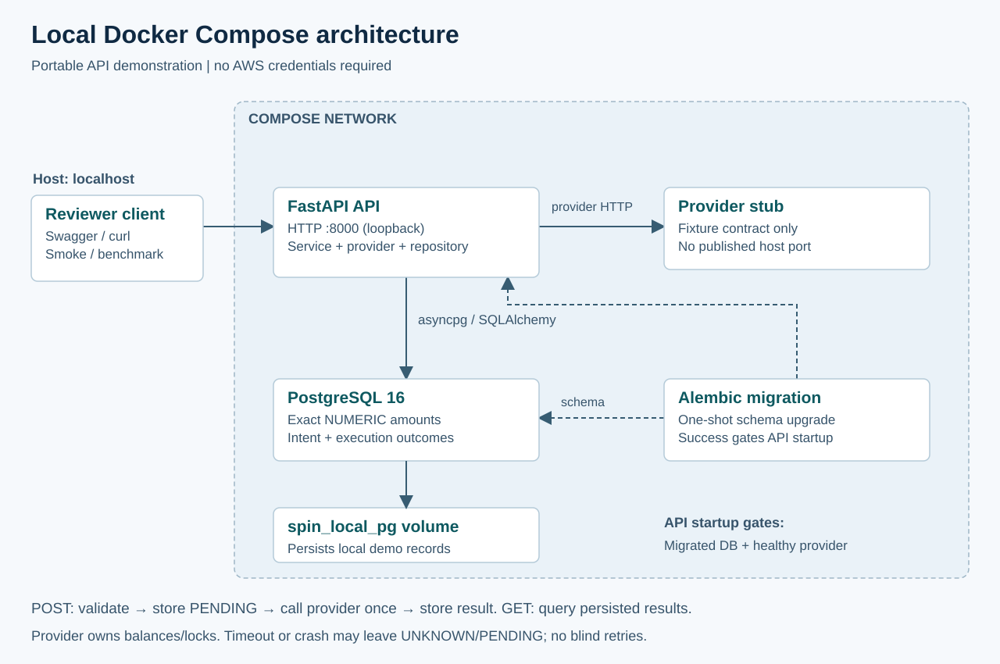
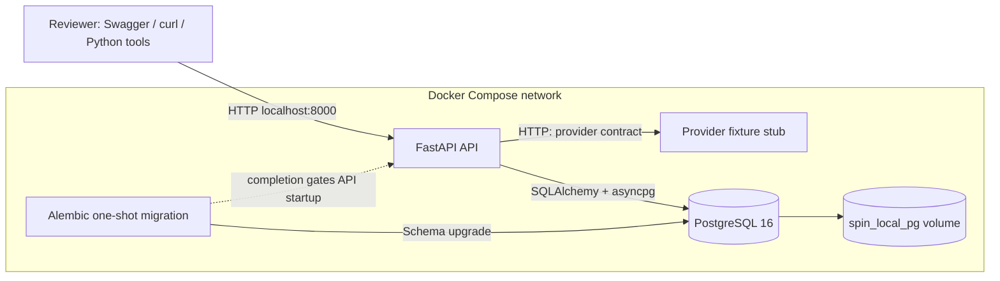

# Local Docker Compose architecture

The PostgreSQL health check gates migrations; the successful migration and healthy mock gate API startup. API/provider run the same built Python image with different entry points. PostgreSQL and API bind host ports to loopback; the provider has no published host port. No AWS access is required.

Requests pass through schema validation, service orchestration and injected provider/repository boundaries. The service persists PENDING intent, calls the provider without holding a database transaction open, then persists EXECUTED or known REJECTED. A timeout/crash can leave UNKNOWN/PENDING. The provider fixture owns only canned contract responses; this API does not calculate balances or manage account locks.

The named volume preserves demo records between container restarts. It is not a backup. Unit fixtures are separate disposable databases and should not use the running demo database. Async I/O helps overlap waits, while database pool size, provider latency and CPU remain capacity limits.
